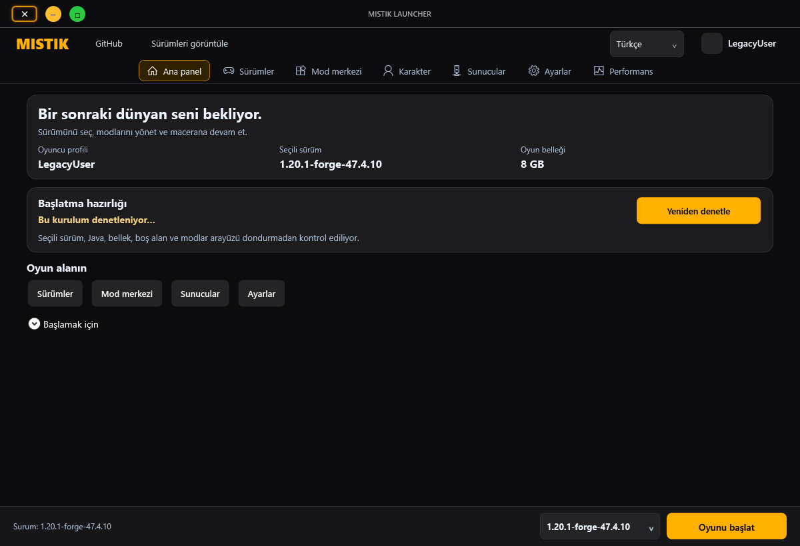
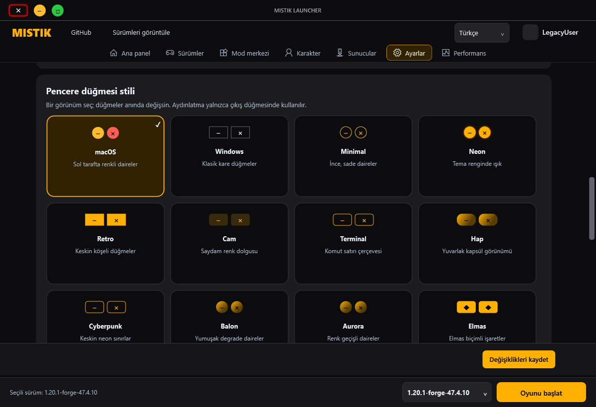

# Mistik Launcher Ultra

**Windows x64 için Minecraft launcher · Türkçe / English**

[⬇ Son sürümü indir](https://github.com/gamer3434/MistikLauncherUltra/releases/latest) · [Web sitesi](https://mistiklauncherultra.web.app/) · [Sürüm notları](https://github.com/gamer3434/MistikLauncherUltra/releases)



## Öne çıkanlar

- **Sürüm yönetimi:** Vanilla, Fabric, Forge, NeoForge ve Quilt profilleri.
- **Mod merkezi:** Modrinth araması, açıklama/galeri, uyumlu sürümler ve bağımlılık kurulumu. Mod taşıma, yedekleme ve geri yükleme.
- **Kişiselleştirme:** 20 renk teması, 16 pencere düğmesi stili, skin ve yerel sunucu araçları.
- **Güncelleme ve kurtarma:** Güncelleme/sürüm düşürme Ayarlar’da; onarım kurucuda. Oyuncu ayarları, modlar ve dünyalar korunur.



*Görüntüler test profiliyle alınmış gerçek launcher arayüzüdür.*

## Hızlı başlangıç

1. Son sürümden **Online** veya **Offline** kurucuyu indir. Taşınabilir kullanım için ZIP’in tamamını çıkarıp `MistikLauncher.exe` dosyasını aç.
2. Oyuncu adını ve belleği Ayarlar’dan seç; oyun sürümünü kurup **Oyunu başlat** düğmesini kullan.

Veriler `%APPDATA%\.mistik_ultra` klasöründedir. Kullanım/hata paylaşımı varsayılan kapalıdır. Microsoft hesabıyla giriş henüz desteklenmez.

<details>
<summary>Geliştirici bilgileri</summary>

Windows ve .NET 8 SDK gerekir:

```powershell
dotnet build MistikLauncher/MistikLauncher.csproj -c Release
dotnet run --project Validation -c Release -- artifacts/screenshots-ordinary
./scripts/Build-Package.ps1
./scripts/Build-Installers.ps1
```

[Gizlilik ve depo bilgileri](docs/REPOSITORY-PRIVACY.md)

</details>
